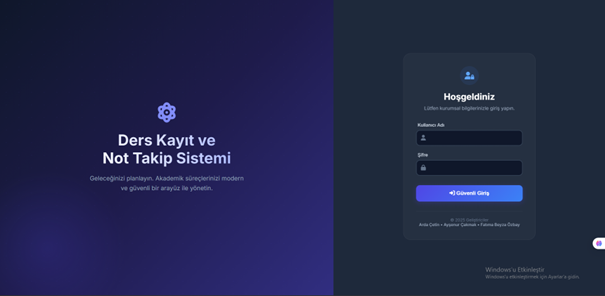
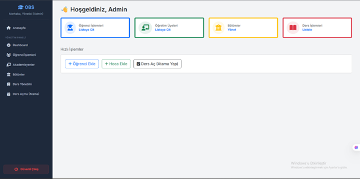
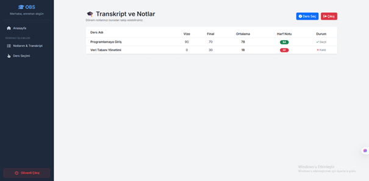
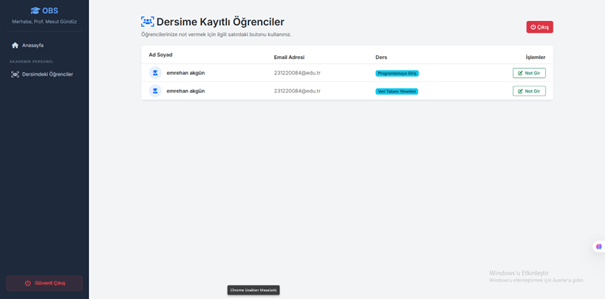

# Course Registration and Grade Tracking System

This project is a Course Registration and Grade Tracking System developed to manage university course enrollment and grading processes in a secure and structured manner.

The system supports three different user roles: Admin, Student, and Instructor. Each role can only perform actions within its authorization scope, ensuring role-based access control and data security.

## Technologies
- ASP.NET Core MVC
- C#
- SQL Server
- Entity Framework Core
- HTML, CSS, Bootstrap

## Database Design
The system uses a custom-designed SQL Server database created specifically for this project. All tables and relationships were designed manually, and the application accesses the database through Entity Framework Core.

## User Roles and Features

### Admin
- Add, update, and delete students
- Add, update, and delete instructors
- Add and delete courses
- Open course offerings for a term
- Assign instructors to courses
- Manage departments
- View student and instructor lists

### Student
- View available courses
- Register for courses related to their department
- View grades (midterm, final, average, letter grade)
- Duplicate course registration is not allowed

### Instructor
- View assigned courses
- View enrolled students
- Enter and update student grades

## CRUD Operations
- **Create:** Student creation, course registration  
- **Read:** Student listing, grade viewing  
- **Update:** Grade updates  
- **Delete:** Student deletion  

## Highlights
- **Role-based access:** session-based login that routes each user to the Admin, Student or Instructor panel; each panel checks the session and redirects unauthenticated users to login
- **Relational schema** with 10 tables and foreign keys (departments, courses, course offerings, terms, enrollments, grades, users, roles)
- **Grades computed in the database:** `Ortalama` (average) and `HarfNotu` (letter grade) are SQL Server computed columns, so they can never drift from the raw midterm, final and make-up scores
- **Business rules:** students can only enroll in courses of their own department and cannot register for the same course twice

## Installation
Requirements: .NET 8 SDK, SQL Server (Express is enough), Visual Studio 2022.

1. Clone the repository:
   ```bash
   git clone https://github.com/ardactin/Student-Information-System.git
   ```
2. Set your connection string in `DersKayitNotTakip/appsettings.json` (`ConnectionStrings:DefaultConnection`). The default points to a local `.\SQLEXPRESS` instance.
3. Create the database from the EF Core model. In Visual Studio's **Package Manager Console**:
   ```powershell
   Add-Migration InitialCreate
   Update-Database
   ```
4. Add the roles and a first admin account:
   ```sql
   INSERT INTO Yetki (YetkiAdi) VALUES ('Admin'), ('Ogrenci'), ('OgretimUyesi');
   INSERT INTO Kullanici (KullaniciAdi, Sifre, YetkiID) VALUES ('admin', 'admin123', 1);
   ```
5. Run the project and log in as `admin`. Students and instructors can then be created from the admin panel.

## Screenshots






## Project Purpose
This project was developed to demonstrate MVC architecture, database design, role-based authorization, and real-world CRUD operations using ASP.NET Core and SQL Server.

## Possible Improvements
- Hash passwords (e.g. ASP.NET Core `PasswordHasher`) instead of storing them as plain text
- Replace session checks with ASP.NET Core Identity and `[Authorize]` attributes
- Add unit tests for the enrollment rules

## Note
Developed as a 3-person team project for a university course.
